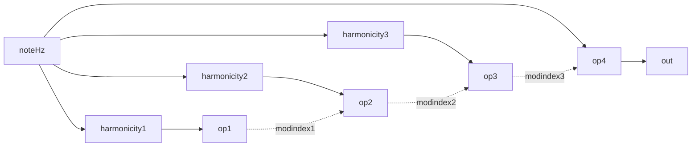
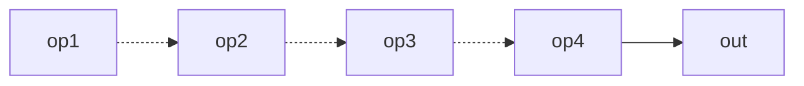
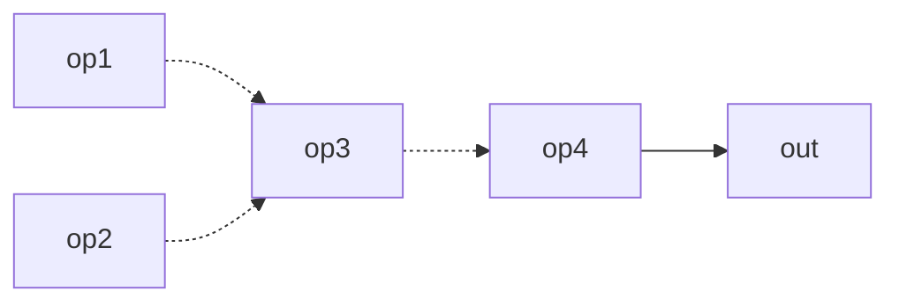
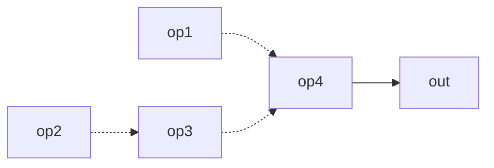
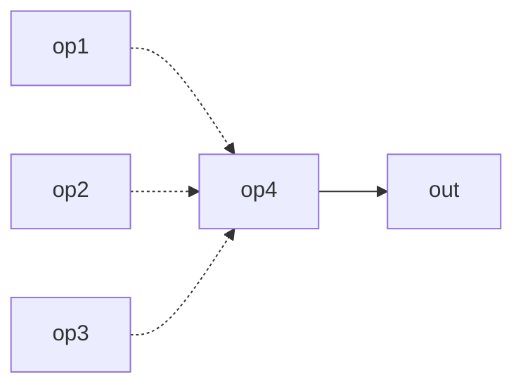
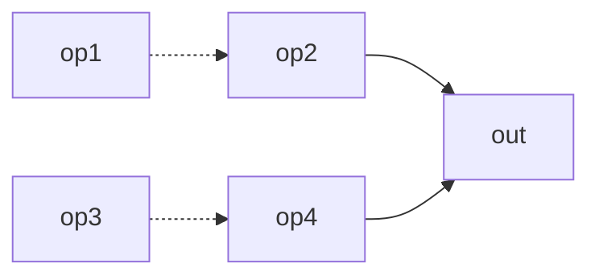
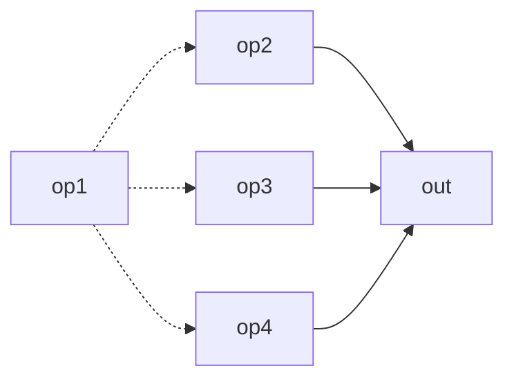
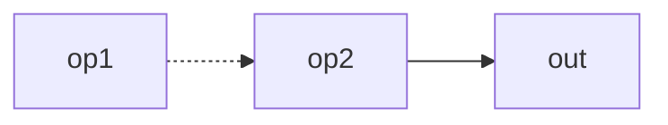
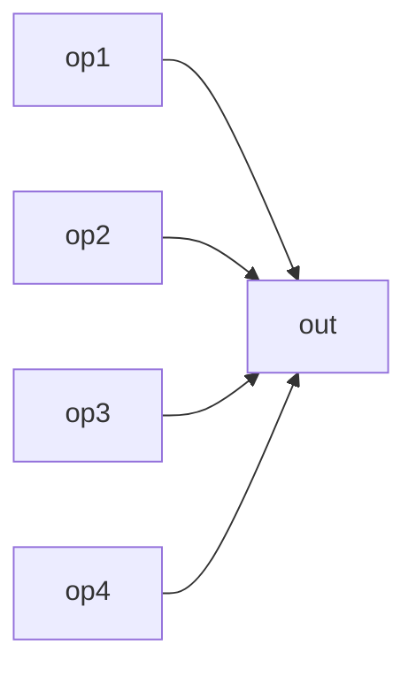

FM-style algorithmic synthesizer with 4 operators and 8 modulation algorithms.

**Active runtime:** Daisy WASM (`algovoice` in `zss_voice.cpp`) implements the same 8 routings below. FM depth matches Tone: `carrier_hz += (note_hz * modindex) * modulator` (enveloped op). `#synth osc1`–`osc4` set each operator wave. Select with `#synth algo0` … `#synth algo7`.

Solid arrows below are **audio** into the mix. Dashed arrows are **FM** into another operator’s frequency.

## Overview

Each operator has its own oscillator and envelope. Harmonicity scales op1–op3 vs the note; modindex scales FM depth on the dashed links.

That sketch is the classic serial chain (algo 0). Other algorithms change which ops modulate which, and which ops are mixed to the output.

## Algorithm reference

| Algo | Modulation | Output |
|------|------------|--------|
| 0 | 1→2→3→4 serial | op4 |
| 1 | 1,2→3→4 | op4 |
| 2 | 1→4, 2→3→4 | op4 |
| 3 | 1,2,3→4 | op4 |
| 4 | 1→2, 3→4 | op2 + op4 |
| 5 | 1→2, 1→3, 1→4 | op2 + op3 + op4 |
| 6 | 1→2 | op2 |
| 7 | none (additive) | op1 + op2 + op3 + op4 |

### algo0 — serial stack

### algo1 — dual into 3→4

### algo2 — side carrier + stack

### algo3 — three into carrier

### algo4 — dual FM pairs

### algo5 — one modulator, three carriers

### algo6 — single pair

### algo7 — additive

## Parameters (`#synth` after `algoN`)

| Parameter | Description |
|-----------|-------------|
| `harmonicity1`…`3` | Freq ratio for op1–op3 vs note |
| `modindex1`…`3` | FM depth on the dashed links |
| `osc1`…`osc4` | Operator wave (basic / pulse / pwm) |
| `env1`…`env4` | Per-operator ADSR |
| `env` / `port` / `vol` | Outer voice envelope, glide, level |

Player recipes: [Synth voices](/synth/voices#algo-fm-algo0algo7).
