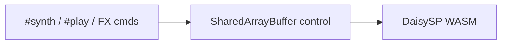
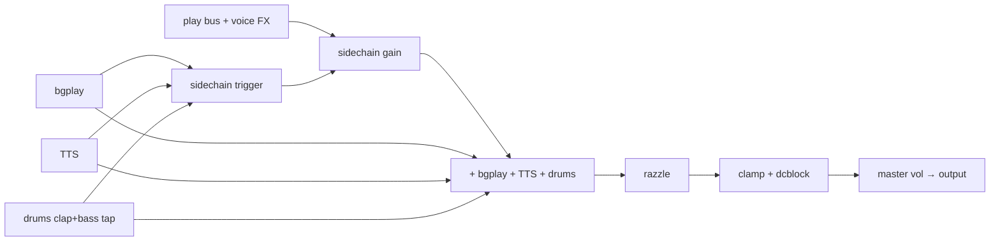

How the DaisySP synth implements voices, FX, drums, and the master chain.

Deep param catalogs: [voice-types-reference.md](voice-types-reference.md), [fx-types-reference.md](fx-types-reference.md), [audiochain.md](audiochain.md), [drums.md](drums.md), [CUTOVER.md](../backend/daisy/CUTOVER.md).

## Runtime

Playback boots through [`createsynthbackend`](../backend/synthbackendfactory.ts), which only starts Daisy. DSP is C++ under [`native/zss/`](../backend/daisy/native/zss/) with the WASM API in [`zss_daisy_synth.cpp`](../backend/daisy/native/zss_daisy_synth.cpp) and the worklet in [`daisyengine.ts`](../backend/daisy/daisyengine.ts). Shared SAB helpers live in [`backend/wasm/`](../backend/wasm/).

**DaisySP modules in use:** `Oscillator`, `Adsr` (doot/sparkle/algo operators only), `Decimator`, `Overdrive`, `Svf`, `Phasor`, `DelayLine`, `Chorus`, `WhiteNoise`, `DcBlock`, `OnePole`, `Autowah`, `StringVoice` (`#synth pluck` strike), `ModalVoice` (bells), `Drip`, and `SyntheticBassDrum` (tom). Bass is a custom membrane. **`#synth env`** on play voices uses **`ZssLinearEnv`** (linear ADSR, note-on reset), not DaisySP `Adsr`. Envelope checks are `yarn task run ops:daisy:adsr-parity:test` (Jest `adsrenvcurve`). **`#synth string`** uses the SOS ensemble (saws + `Svf`/`OnePole`). **Voice FX** are parallel sends in `applyfxgroup()` ([parallel-fx-bus.md](parallel-fx-bus.md)). **Main compressor** is a Tone-shaped knee in `maincompressor()`. **Sidechain duck** is a custom power-domain envelope on the play bus. **`#reverb`** uses DaisySP-LGPL **ReverbSc** plus predelay and `tanh(wet × kReverbPostGain)`.

---

## Table 1 — Voice types (`SOURCE_TYPE`)

Enum: [`shared/sourcetype.ts`](../shared/sourcetype.ts). Dispatch: `VoiceType` in [`zss_daisy_synth.cpp`](../backend/daisy/native/zss_daisy_synth.cpp).

| ZSS name | Enum | DaisySP | Closest [DaisySP feature](https://github.com/electro-smith/DaisySP#-features) | Key files |
|----------|------|---------|-------------------------------------------------------------------------------|-----------|
| `sine`/`square`/…/`fat*` | `SYNTH` | `ZssLinearEnv` + `Oscillator` | Subtractive / FM | cpp `synthsource()` |
| `retro` | `RETRO_NOISE` | Custom LFSR tables + ADSR | Noise (custom) | `noisewave.ts` |
| `buzz` | `BUZZ_NOISE` | same, different LFSR tap | Noise | `noisemeta.ts` |
| `clang` | `CLANG_NOISE` | same | Noise | same |
| `metallic` | `METALLIC_NOISE` | same + amplitude norm | Noise | same |
| `hollow` | `HOLLOW_NOISE` | FFT hollow table | Noise (custom spectral) | `noisewave.ts` |
| `noise` | `WHITE_NOISE` | PRNG white table | Whitenoise (custom PRNG) | `noisewave.ts` |
| `bells` | `BELLS` | `ModalVoice` + sparkle + `voiceenv` | Physical modeling + FM sparkle | cpp `processvoice()` |
| `doot` | `DOOT` | `Oscillator` + `Adsr` | Drum / physical | cpp `dootvoice()` |
| `algo0`–`algo7` | `ALGO_SYNTH` | 4× `Oscillator` + 5× `Adsr` | FM (4-op routing) | [algosynth.md](algosynth.md) |
| `string` | `STRING_VOICE` (algo 0) | SOS ensemble (`stringmachinevoice`) | Subtractive string-machine | cpp `stringmachinevoice()` |
| `pluck` | `STRING_VOICE` (algo 1) | `StringVoice` × `voiceenv` | Physical modeling | cpp `processvoice()` |
| `drip` | `DRIP_VOICE` | `Drip` × `voiceenv` | Physical modeling | cpp `processvoice()` |
| `flute`–`panpipe` | `WIND_VOICE` | `windvoice()` formant bank + breath burst | Subtractive + formants | cpp `zss_sosvoices.cpp` |
| `piano`/`epiano` | `PIANO_VOICE` | `pianovoice()` + `Fm2` on epiano | FM + `Fm2` tine | cpp `zss_sosvoices.cpp` |
| `timpani` | `TIMPANI_VOICE` | `timpanivoice()` `ModalVoice` | Physical modeling | cpp `zss_sosvoices.cpp` |
| `violin`/`viola` | `BOWED_VOICE` | `bowedvoice()` delayed vibrato | Subtractive bowed | cpp `zss_sosvoices.cpp` |
| `nylon`/`steel` | `GUITAR_VOICE` | `guitarvoice()` + `StringVoice` | Physical modeling | cpp `zss_sosvoices.cpp` |
| `tonewheel`/`drawbar` | `ORGAN_VOICE` | `organvoice()` scanner vibrato + drawbars | Additive drawbars | cpp `zss_sosvoices.cpp` |

**SYNTH sub-modes** ([`wasmosctype.ts`](../backend/wasm/wasmosctype.ts)): basic waves, pulse/PWM, AM, FM, fat.

---

## Table 2 — Voice FX

Parallel wet sends. Vibrato is pitch modulation, not a wet send. See [fx-types-reference.md](fx-types-reference.md).

| ZSS FX | Aliases | DaisySP | Key files |
|--------|---------|---------|-----------|
| `fc` | `fcrush` | `Decimator` | cpp `applyfxgroup()` |
| `echo` | — | `DelayLine` | cpp |
| `reverb` | — | **ReverbSc** + predelay (LGPL) | cpp |
| `autofilter` | — | `Svf` + `Phasor` | cpp |
| `vibrato` | — | Pitch cents + `fxvibratolfo` | cpp |
| `distortion` | `distort` | `Overdrive` | cpp |
| `autowah` | — | `Autowah` | cpp |

**Bus layout:** 4 groups via [`voicefxgroup.ts`](../voicefxgroup.ts). SAB: [`wasmfxstate.ts`](../backend/wasm/wasmfxstate.ts).

---

## Table 3 — Master chain

| Processor | Role | DaisySP | Key files |
|-----------|------|---------|-----------|
| Sidechain duck | Duck `#play` when bg/TTS/drums hit | Custom envelope + TTS key | cpp |
| Main compressor | Bus dynamics | Custom knee compressor | cpp `maincompressor()` |
| Razzle | Master character | Manual vibrato delay + `Chorus` + hiss | cpp |
| Output safety | Peak control | `Limiter` | cpp `zss_process()` |
| DC block | Master out | `DcBlock` | cpp `zss_process()` |
| Master trim | Level staging | **-10 dB trim**, 0 makeup (no comp); play **Tone volumetodb(20)**; drum **play × 1.35** | [`zss_daisy_synth.cpp`](../backend/daisy/native/zss_daisy_synth.cpp) |

**Sidechain params:** threshold −42 dB (power domain), ratio 5:1, attack 5 ms, release 60 ms, mix 0.50, makeup +12 dB; bg/TTS send −12 dB, drum send −28 dB.

**FX bus gain:** per-send linear gain from [`wasmfxstate.ts`](../backend/wasm/wasmfxstate.ts) (`on` → 50). Echo/reverb use send×wet; **`wet_sum`** × 1.4 then the return compressor before `dry + wet_sum`. Offline matrix: `yarn task run ops:daisy:level-stability:test:fxmatrix`.

---

## Table 4 — Drums (12 IDs)

[DaisySP Drums](https://github.com/electro-smith/DaisySP/tree/master/Source/Drums/) where a class fits. Unmatched IDs stay custom. Drum fixtures are Daisy renders in `parity-metrics-daisy.json`.

| ID | Drum | DaisySP | Key files |
|----|------|---------|-----------|
| 0 | Tick | Custom noise + EQ | cpp `drumtick()` |
| 1 | Tweet | Custom noise + EQ | cpp `drumtweet()` |
| 2 | Cowbell | Custom dual square + bandpass | `drumcowbell()` |
| 3 | Clap | `WhiteNoise` + EQ | `drumclap()`; sidechain tap |
| 4 | Hi snare | Custom | cpp |
| 5 | Hi woodblock | Custom | `drumwoodblock(true)` |
| 6 | Low snare | Custom | cpp |
| 7 | Low tom | `SyntheticBassDrum` | cpp |
| 8 | Low woodblock | Custom | `drumwoodblock(false)` |
| 9 | Bass | Custom sine + expo pitch | `drumbass()`; sidechain tap |
| 10 | Crash | Custom modal cymbal | cpp `zss_drums.cpp` |
| 11 | Ride | Custom modal cymbal + ping | cpp `zss_drums.cpp` |

---

## Table 5 — DaisySP modules

| DaisySP category | Used | Notes |
|------------------|------|-------|
| `Oscillator` | Yes | Voices, FX LFOs, razzle, custom drums |
| `Fm2` | Yes | `#synth epiano` tine model |
| `Adsr` | Yes | Gated voices and algo operators |
| `Decimator`, `Overdrive`, `Svf`, `Phasor` | Yes | Voice FX |
| `DelayLine` | Yes | Echo |
| `Chorus` | Yes | Razzle chorus half |
| `WhiteNoise` | Yes | Drum noise via `drumnoise()` |
| `Limiter`, `DcBlock` | Yes | Master output |
| `StringVoice` | Yes | `#synth pluck`; `#synth string` is the SOS ensemble |
| `SyntheticBassDrum` | Yes | Tom (7); bass (9) is custom |
| `Compressor` (LGPL) | Yes | Main bus |
| `HiHat` | No | Tick and tweet stay custom |
| `KarplusString` (direct) | No | Used inside `StringVoice` |

---

## Primary source files

| Topic | Path |
|-------|------|
| Voice types | [`shared/sourcetype.ts`](../shared/sourcetype.ts), [`zss_daisy_synth.cpp`](../backend/daisy/native/zss_daisy_synth.cpp) |
| FX | [`zss_daisy_synth.cpp`](../backend/daisy/native/zss_daisy_synth.cpp), [`wasmfxstate.ts`](../backend/wasm/wasmfxstate.ts) |
| Master | [`zss_daisy_synth.cpp`](../backend/daisy/native/zss_daisy_synth.cpp) |
| Drums | [`zss_drums.cpp`](../backend/daisy/native/zss/zss_drums.cpp) |
| Build | [`build-daisy.sh`](../backend/daisy/native/build-daisy.sh) |
| Backend factory | [`synthbackendfactory.ts`](../backend/synthbackendfactory.ts) |
| Firmware | [`firmware/audio.ts`](../../../firmware/audio.ts) |
